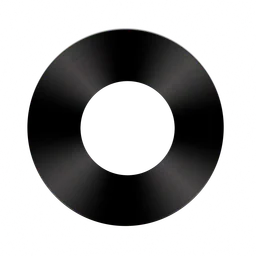

  

    

      
    

    

      
当前曲目

      <h2 class="music-now__title" id="music-now-title">未选择曲目</h2>
      
点击下方任意曲目开始播放

      <audio id="music-audio" preload="none"></audio>
      

        <button type="button" class="music-ctl__icon" id="music-toggle" aria-label="播放">
          <svg viewBox="0 0 24 24" width="20" height="20" aria-hidden="true"><path fill="currentColor" d="M8 5l12 7-12 7z"/></svg>
        </button>
        0:00
        

          

          
        

        0:00
        <button type="button" class="music-ctl__icon" id="music-mute" aria-label="静音">
          <svg viewBox="0 0 24 24" width="20" height="20" aria-hidden="true"><path fill="currentColor" d="M4 9h3.5L12 5.5v13L7.5 15H4z"/><path fill="currentColor" d="M15.2 8.8l1.3-1.3 2.2 2.2 2.2-2.2 1.3 1.3-2.2 2.2 2.2 2.2-1.3 1.3-2.2-2.2-2.2 2.2-1.3-1.3 2.2-2.2z"/></svg>
        </button>
        <input type="range" class="music-ctl__vol" id="music-vol" min="0" max="100" step="1" value="100" aria-label="音量">
      

    

  

  

    

      
      
本页不预加载音频，点击曲目后才开始缓冲；首次播放时显示实际时长。

    

  

  

    <aside class="music-lyrics" id="music-lyrics" aria-label="歌词">
      

        歌词
        —
      

      

        
点击曲目开始播放，歌词会跟随高亮。

      

    </aside>
  

